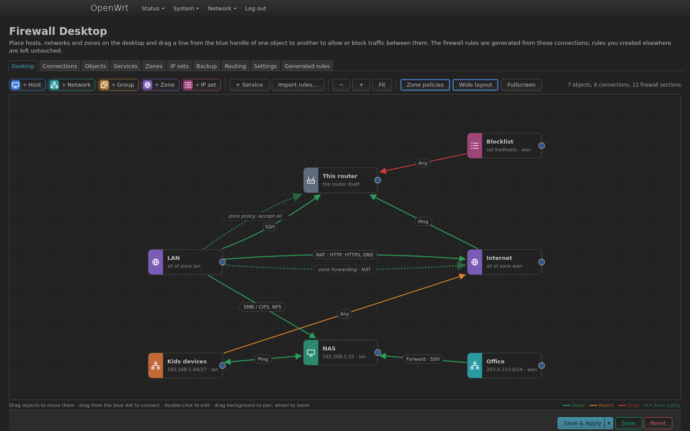
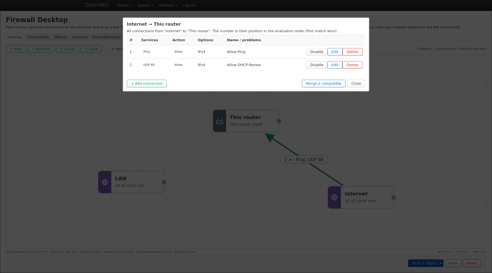
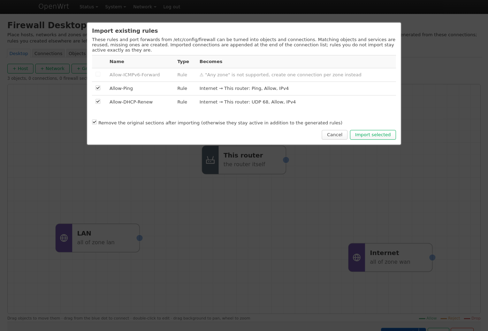

# luci-app-fwdesktop

An object based firewall editor for **OpenWrt 25.12** (fw4 / nftables), built as a
modern client side LuCI app.

(It's BETA! backup your /etc/config/firewall before testing)

Instead of editing rule lists, you place **objects** on a desktop (hosts, networks,
zones, groups, IP sets, the router itself) and draw **connections** between them.
Each connection carries services, an action (allow / reject / drop), optional NAT
and logging. The app turns these connections into ordinary fw4 `rule`, `redirect`
and `nat` sections.



## Features

- **Objects:** host, network (CIDR / range), zone ("the Internet", "all of LAN"),
  group (may span zones), fw4 IP set, and the router itself.
- **Services:** 36 built in (HTTP, DNS, SSH, WireGuard, SIP, RTMP, …), your own
  (TCP/UDP ports and ranges, ICMP types, any protocol such as ESP or IGMP) and
  service groups.
- **Connections:** allow / reject / drop, masquerading, port forwarding with a
  different public port, IPv4/IPv6 only, logging, extra fw4 options such as
  `limit=10/sec` or time ranges.
- **One line per direction:** hover a line to see all its connections, click it
  to manage them in one dialog, merge connections that only differ in services.
- **Reset affected connections on apply** (optional, *Settings* tab): after
  Save & Apply the conntrack entries of added, changed or removed rules are
  deleted, so established connections are checked against the new rules
  (or the whole table is flushed, if chosen).
- **Backup / restore:** download `/etc/config/firewall` and `/etc/config/fwdesktop`
  as one JSON file and restore it with a preview; restores are applied with
  LuCI's rollback protection.
- **Colours:** give any object its own symbol colour (RGB picker); stored in
  `/etc/config/fwdesktop`, never in the firewall configuration.
- **Zone management:** create, edit, rename and delete firewall zones (policies,
  masquerading, MSS clamping, covered networks, zone forwardings); renames
  follow through to forwardings, rules and desktop objects.
- **IP set management:** create, edit, rename and delete fw4 IP sets (entries,
  load file, timeout, counters) on the *IP sets* tab; renames follow through to
  desktop objects and rules.
- **Interface info:** click a zone (or the router) to see its interfaces with
  device, state and live IPv4/IPv6 addresses.
- **Zone policies visible:** zone forwardings (e.g. LAN → WAN) and zones with
  input ACCEPT are drawn as dotted lines.
- **Import** of existing hand written rules and port forwards, including rules
  that use IP sets. Rules the desktop cannot express are listed with the reason
  and stay untouched.
- **Safe to use next to existing rules:** only sections named `fwd_*` in
  `/etc/config/firewall` are written; everything else is left alone. Changes go
  through LuCI's Save & Apply with automatic rollback.
- Live preview of the generated fw4 configuration, problem checks, wide layout
  and fullscreen mode.

| Connections between two objects | Importing existing rules |
|---|---|
|  |  |

## Installation

### Package feed (recommended)

A signed apk feed is published on GitHub Pages with every release. Set it up
once on the router:

```sh
wget -O /etc/apk/keys/fwdesktop-feed.pem https://stifflersmom.github.io/luci-app-fwdesktop/fwdesktop-feed.pem
echo "https://stifflersmom.github.io/luci-app-fwdesktop/packages.adb" >> /etc/apk/repositories.d/customfeeds.list
```

Then install and later update like any other package:

```sh
apk update
apk add luci-app-fwdesktop
apk upgrade luci-app-fwdesktop
```

The public key is also in this repository as `feed/fwdesktop-feed.pem`.

### Prebuilt package

Download `luci-app-fwdesktop-*.apk` from the
[releases](../../releases) and install it on the router:

```sh
apk add --allow-untrusted luci-app-fwdesktop-*.apk
```

The package is architecture independent (`noarch`). It is not signed by the
OpenWrt project, hence `--allow-untrusted`. Then open
**Network → Firewall Desktop** in LuCI.

### As a feed (OpenWrt buildroot or SDK)

```sh
echo "src-git fwdesktop https://github.com/StifflersMom/luci-app-fwdesktop.git" >> feeds.conf
./scripts/feeds update fwdesktop
./scripts/feeds install luci-app-fwdesktop
make menuconfig   # LuCI → Applications → luci-app-fwdesktop
make package/luci-app-fwdesktop/compile
```

### Image builder

Copy the `.apk` into the image builder's `packages/` directory and add
`luci-app-fwdesktop` to `PACKAGES`. The image builder indexes and signs local
packages itself.

### Building the package yourself

`scripts/build-apk.sh` downloads the official OpenWrt 25.12 SDK and builds the
package (about two minutes). The release workflow uses the same script for
every `v*` tag.

## How it works

- The model lives in `/etc/config/fwdesktop` (`object`, `service` and
  `connection` sections, plus desktop positions).
- Connections are evaluated in the order shown on the *Connections* tab; the
  first match wins. Generated sections are named
  `fwd_<connection>_<r|d|n><n>` (rule / redirect / nat) and are placed after
  hand written rules.
- Traffic no connection matches is handled by the zone policies, shown on the
  *Generated rules* tab and as dotted lines on the desktop.

## Development

```
luci-app-fwdesktop/
  Makefile                                          LuCI package
  htdocs/luci-static/resources/fwdesktop/model.js   model, rule generator, importer (pure JS)
  htdocs/luci-static/resources/fwdesktop/desktop.css
  htdocs/luci-static/resources/view/fwdesktop/desktop.js   the page
  root/                                             menu, ACL, uci-defaults
tests/
  model.test.js    generator unit tests           node tests/model.test.js
  import.test.js   importer against the stock 25.12 firewall config
  ipset.test.js    IP set objects
  ui-*.js          Playwright end-to-end flows against a test VM
testvm/            QEMU helper for an OpenWrt 25.12 x86-64 test VM
deploy.sh          copy the sources into the test VM without building
```

End-to-end tests expect an OpenWrt 25.12 x86-64 VM with LuCI on
`http://127.0.0.1:8081` (`testvm/start.sh`, root password `test1234`).

Notes:

- When changing the stylesheet, bump `ASSET_REV` in `desktop.js` together with
  `PKG_RELEASE`, otherwise browsers keep a cached `desktop.css`.
- LuCI's build minifies JS with `jsmin`, which cannot parse a regular
  expression literal right after `=>`; use a named constant instead.

## License

Apache-2.0, see [LICENSE](LICENSE).
